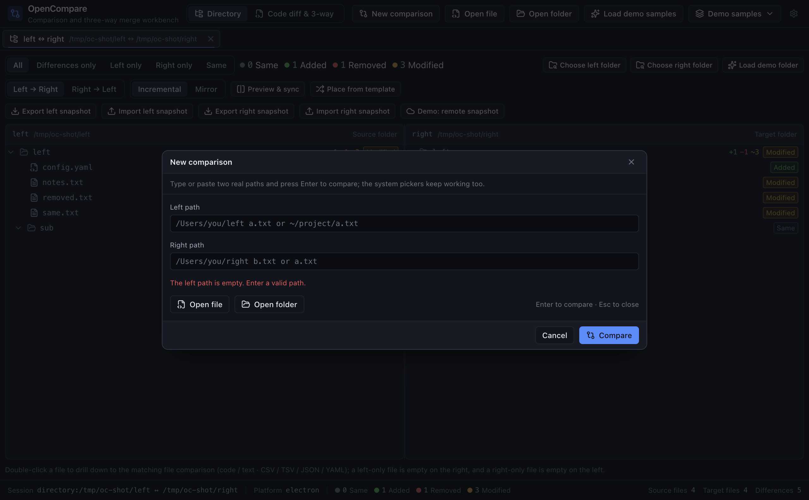
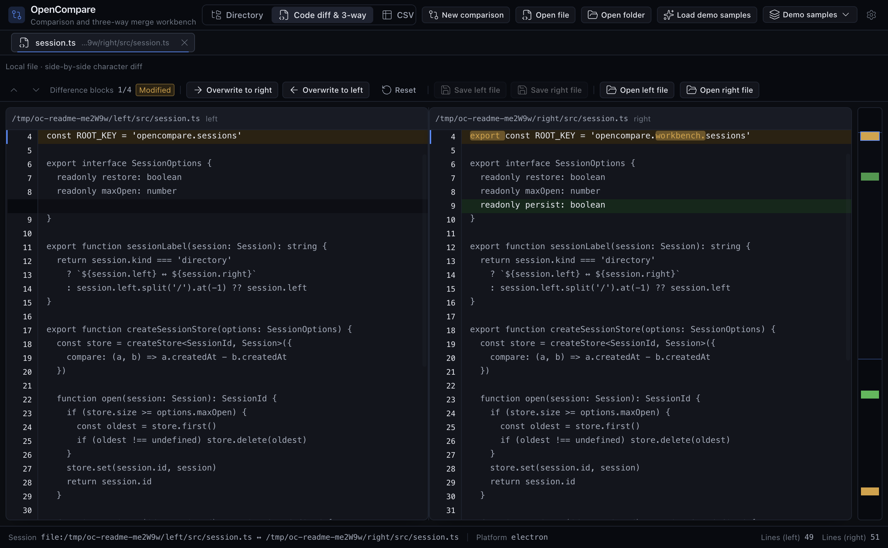

# OpenCompare

[English](./README.md) | 简体中文

> 最新公开版本：[v0.2.12](https://github.com/chaxiu/OpenCompare/releases/tag/v0.2.12) — macOS 安装包经 Developer ID 签名与 Apple 公证。

[](https://github.com/chaxiu/OpenCompare/releases) [](./LICENSE)

OpenCompare 是面向 Beyond Compare 5 Pro 使用场景的现代跨平台桌面对比与三向合并工具：目录对比与同步、代码 diff 与合并、CSV 主键对齐、JSON / YAML 语义对比、目录快照。基于 Electron + React 19 + TypeScript，同一套代码同时提供桌面应用与浏览器预览。





## 下载与安装

- **macOS arm64**：从 [Releases](https://github.com/chaxiu/OpenCompare/releases) 下载 `.dmg`，打开后将 OpenCompare 拖入 Applications，再从 Applications 启动。
- **Windows**：运行 `.exe` 安装包，按向导完成安装后从开始菜单启动。
- **Linux**：先 `chmod +x` 再运行 `.AppImage`；或用 `sudo apt install ./opencompare_amd64.deb` 安装 `.deb`。

所有已发布版本都在 [Releases 页](https://github.com/chaxiu/OpenCompare/releases)。

## 核心能力

- **目录对比与同步**：多层嵌套双目录树对比，按 `相同 / 新增 / 删除 / 修改` 分类每个节点，增量同步与镜像同步先干跑预览再落盘。
- **代码 diff 与三向合并**：行级与行内字符级高亮、同步滚动、逐差异块覆写，diff3 冲突块逐块解决。
- **CSV 主键对齐**：按选定主键列对齐 CSV / TSV 行，容忍行乱序与列偏移，可按时态过滤行。
- **JSON / YAML 语义对比**：按 JSON Pointer 节点路径比对解析后的文档，忽略键序、注释与缩进。
- **快照协议（`.ocsnap.json`）**：把目录导出为带元数据与 SHA-256 的规范化快照文档，导入任意一侧后重新对比。

## 快速上手

1. 用**新建对比**打开两个路径，或用**打开文件夹**分别选择左右两侧；不加载样本也能直接对比。
2. 看四种状态：相同 / 新增 / 删除 / 修改。
3. 双击文件下钻到对应的代码、CSV 或 JSON 视图。
4. 预览同步清单后，应用增量或镜像改动。

## 环境要求与开发

- Node.js >= 20.19
- pnpm 10

```bash
pnpm install
pnpm dev        # 启动 Electron 桌面窗口
pnpm dev:web    # 浏览器预览
pnpm lint       # ESLint
pnpm typecheck  # tsc --noEmit
pnpm test       # vitest
pnpm build      # 桌面三进程包
pnpm build:web  # 浏览器静态产物
```

## 项目结构

```text
src/main/       Electron 主进程：窗口生命周期、IPC handler、真实文件系统访问
src/preload/    contextBridge 安全桥接，仅暴露白名单 channel
src/core/       纯算法与领域模型，零 Electron / DOM 依赖
src/renderer/   React 19 UI：工作台、场景视图与基础组件
src/shared/     跨进程共享类型、PlatformPort 契约与内置样本
```

## 已知问题

当前没有已知未修复问题。可复现的问题请提交到 [Issues](https://github.com/chaxiu/OpenCompare/issues)。

## 证据与文档

[发布流程](docs/release-process.md) · [签名凭据](docs/release-signing.md) · [符号链接口径](docs/symlink-no-follow.md) · [大目录内存](docs/perf/large-directory-memory.md)。

Performance & memory evidence：[只读诊断](docs/perf/upsert-memory-diagnosis-2026-10-23.md) 与 [大目录内存](docs/perf/large-directory-memory.md)。

教训与口径沿革：[历史结论、一次性事故与已闭环实测口径](docs/lessons.md)。

## Open Rebuilds 001 平替

OpenCompare 是 Beyond Compare 5 Pro 的免费 MIT 平替，收录为 [Open Rebuilds](https://github.com/munk-sh/open-rebuilds) 系列第 001 号项目。

## 许可

MIT，见 [LICENSE](./LICENSE)。
